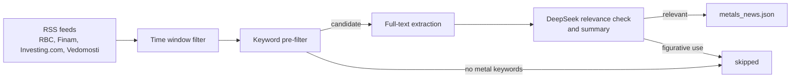

# Precious Metals News Analyzer

A news pipeline that collects Russian financial news from RSS feeds, finds articles about gold, silver, platinum and palladium as commodities or investments, and summarizes them with an LLM.


## How it works



1. **Collect.** `feedparser` reads each source's RSS feed and keeps entries inside the time window (24 h by default, 7 days in `main.py`).
2. **Pre-filter.** A cheap keyword pass with word stems for each metal in Russian and English drops most articles before any API call.
3. **Extract.** The article page is fetched, and the body text is pulled out with BeautifulSoup by trying a list of common article selectors.
4. **Analyze.** The LLM gets the title and text and returns strict JSON: `is_relevant`, `metals`, `summary`, `score`, `reason`. The prompt tells it to reject figurative uses such as "golden medal" or "silver medalist". If the API isn't available, a fallback that checks for economic terms takes over.
5. **Save.** Relevant items go to `metals_news.json` along with run metadata: how many metals were mentioned, the average relevance and processing stats per stage.

## Modules

| File | Responsibility |
|------|----------------|
| `parser.py` | `MetalsNewsParser`: source registry, RSS parsing, orchestration, stats, JSON export |
| `filters.py` | `NewsPreFilter`: keyword dictionaries and the pre-filter |
| `extractor.py` | `ContentExtractor`: fetches article pages and extracts their text |
| `analyzer.py` | `OpenRouterAnalyzer`: LLM calls, response parsing, fallback |
| `main.py` | CLI entry point: logging, `.env` check, run |

## Getting started

```bash
git clone https://github.com/XQwart/Precious-Metals-News-Analyzer.git
cd Precious-Metals-News-Analyzer
pip install -r requirements.txt
cp .env.example .env        # set OPENROUTER_API_KEY
python main.py
```

Or use it as a library:

```python
from parser import MetalsNewsParser

parser = MetalsNewsParser()
items = parser.parse_all_sources(max_age_hours=24)
parser.save_to_json(items)
```

## Output

```json
{
  "metadata": {"parsed_at": "...", "total_news": 12, "model": "deepseek/deepseek-chat", "...": "..."},
  "news": [
    {"title": "...", "url": "...", "source": "...", "metals": ["gold"], "published": "...",
     "ai_summary": "...", "relevance_score": 0.9}
  ]
}
```

## License

MIT
